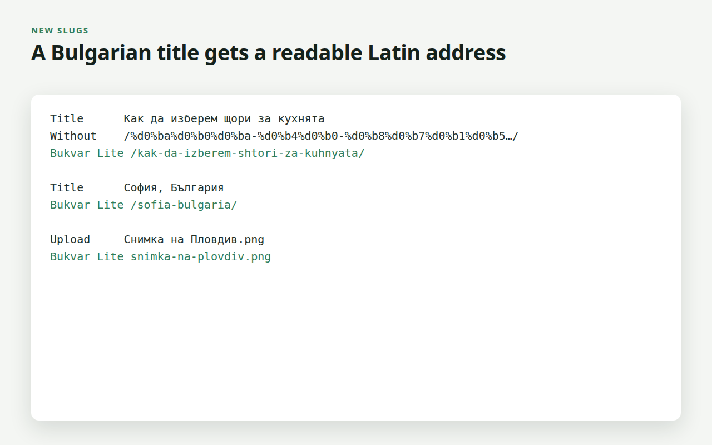

# Bukvar Lite by PN Scripts

A free WordPress plugin (GPL-3.0-or-later) that writes **new** Bulgarian
Cyrillic slugs and upload file names in Latin, by the Streamlined System of
the Bulgarian Transliteration Act (2009): `София, България` becomes
`/sofia-bulgaria/`, `Снимка на Пловдив.png` becomes `snimka-na-plovdiv.png`.

Existing slugs are never changed, so no address of the site moves. Three
switches live on Settings, Permalinks (slugs, file names, lower-case file
names). The full edition, Bukvar, adds a batch converter for existing slugs
with 301 redirects, Russian and Ukrainian tables and WP-CLI.



## Develop

```
composer install
vendor/bin/phpunit      # transliteration rules, file names, plugin filters
./build.sh              # dist/bukvar-lite-1.0.0.zip and dist/wporg-assets/
tools/smoke.sh          # real WordPress on SQLite: slugs, uploads, settings form, uninstall
node tools/render.mjs tools/images.mjs   # icons, banners, screenshots in assets/
```

`readme.txt` is the WordPress.org readme; `assets/` is the SVN `/assets`
folder (banners 772×250 and 1544×500, icons 128×128 and 256×256,
screenshots).

## Licence

GPL-3.0-or-later. Copyright (c) 2026 ПН СКРИПТС ЕООД (PN Scripts).
